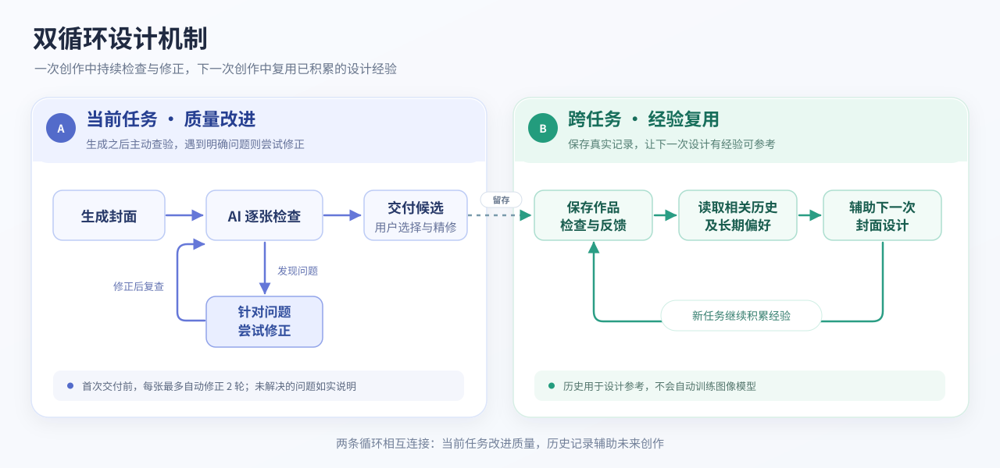

<h1 align="center">Krystal Cover Design</h1>

<p align="center"><strong>内容想好了，做封面还要花多少时间？</strong></p>

<p align="center">一款从创意到成图的 AI 人物封面设计 Skill，<br>能够主动检查、尝试修正，并复用历史设计经验。</p>

<p align="center"><a href="#效果预览">封面示例</a> · <a href="#快速开始">开始安装</a></p>

把文章、视频提纲或选题交给 AI，它会先策划标题与构图，再按你确认的方向生成两张候选封面，并逐张检查成图质量。你负责选择方向、把关审美，AI 负责设计执行与精修。创作记录和明确保存的长期偏好，也能成为下一次设计的参考。

当前固定生成 **3:4 竖版人物封面**，适用于小红书及其他使用该画幅的内容场景。

---

## 效果预览

以下是本项目围绕书签管理主题生成的两张测试封面，分别以人物和产品界面为画面重点。

<table>
  <tr>
    <td></td>
    <td></td>
  </tr>
</table>

---

## 创作场景

无论是小红书图文、视频封面，还是其他需要 3:4 竖版视觉设计的内容，都可以从已有的文章、提纲或选题开始创作。让每一次创作都留下经验，让 AI 越用越懂你的风格。

| 创作需求 | Krystal Cover Design 能做什么 |
|---|---|
| **内容写好了，封面还没方向** | 根据主题提出标题与构图方案，帮助确定视觉表达。 |
| **AI 出图了，还要反复检查修改** | 主动检查文字、人物与构图等问题，尝试修正后再交付。 |
| **希望长期保持自己的封面风格** | 使用可选视觉规范，并复用明确保存的个人设计偏好。 |
| **不想每次都从头调整提示词** | 参考历史作品、检查问题和修改记录，减少重复摸索。 |

适合持续创作内容、希望借助 AI 完成封面设计，同时保留个人审美与决策权的创作者。

---

## 核心优势

### 01｜从创意到成图，完整的 AI 设计流程

**先给方案，再做设计。**

AI 理解内容并提出标题与构图方案。你负责选择方向、确认设计，AI 继续完成提示词设计、封面生成与后续精修。

从创意构思到最终成图，一套流程完成。

### 02｜自己检查问题，自己尝试修正

**生成后逐张检查，发现问题时尝试修正。**

生成后主动检查人物、文字、画质、构图和画幅。发现问题时，针对存在问题的版本尝试修正，并再次检查。

减少需要用户逐项发现和指出的问题。

### 03｜复用历史经验，改进后续设计

**过去的作品、问题和反馈，都能为新设计提供参考。**

Skill 会保存每次创作的设计记录，并在后续任务中参考相关历史。

- **质量经验积累：** 记录 AI 发现的问题、尝试过的修正方法及结果。
- **用户偏好积累：** 保留明确指定的长期视觉偏好，让新设计逐渐贴近个人风格。

通过持续积累和复用历史经验，减少重复摸索，让设计过程有据可依。

### 04｜统一标题风格，也保留创意空间

**让封面标题保持统一风格。**

提供可选的 **KrystalLiu 标题视觉规范**，通过粗黑字体、白黄配色、文字层级和排版规则约束标题表现，并在生成后检查。

也可以根据主题自由选择其他视觉风格。

---

## 快速开始

### 安装 Skill

Krystal Cover Design 可用于 Claude Code、Codex 等支持自定义 Skill 的 AI Agent。以下任选一种安装方式；GitHub 仓库公开后，下载链接和命令即可使用。

**选择安装范围**

| 范围 | 适用场景 | Claude Code | Codex |
|---|---|---|---|
| 个人级 | 在你的多个项目中使用 | `~/.claude/skills/` | `~/.agents/skills/` |
| 项目级 | 仅在当前项目中使用，也可随项目分享 | 项目根目录的 `.claude/skills/` | 项目根目录的 `.agents/skills/` |

`~` 表示当前用户的主目录。项目级 Skill 可能随项目一起提交，请勿将个人照片、配置或创作历史提交到公开仓库。

**方式一：Git 克隆**

先安装 Git，在终端中选择一条命令执行。个人级安装：

```bash
# Claude Code
git clone https://github.com/krystallbing/xhs-cover-skill.git ~/.claude/skills/krystal-xhs-cover

# Codex
git clone https://github.com/krystallbing/xhs-cover-skill.git ~/.agents/skills/krystal-xhs-cover
```

项目级安装：先在终端进入你的项目根目录，再选择一条命令执行：

```bash
# Claude Code
git clone https://github.com/krystallbing/xhs-cover-skill.git .claude/skills/krystal-xhs-cover

# Codex
git clone https://github.com/krystallbing/xhs-cover-skill.git .agents/skills/krystal-xhs-cover
```

**方式二：下载 ZIP**

1. 在 [GitHub 仓库](https://github.com/krystallbing/xhs-cover-skill)点击 **Code → Download ZIP**，然后解压。
2. 将解压后的项目文件夹重命名为 `krystal-xhs-cover`，放入上表中选择的 Skills 目录；目录不存在时先创建。
3. 确认 `SKILL.md` 直接位于 `krystal-xhs-cover` 文件夹内，`references/` 等文件也保留在同一文件夹中，避免多嵌套一层。

**确认安装**

打开新的 Claude Code 或 Codex 会话；项目级安装请在对应项目中打开。输入 `使用 krystal-xhs-cover 帮我设计封面`，确认 Agent 能识别该 Skill 并开始其配置或设计流程。如果没有识别，检查安装路径与 `SKILL.md` 所在位置，然后重新启动 Agent 再试。识别成功不代表当前环境一定具备图片生成能力，具体要求见下方。

其他 Agent 请按照各自的 Skill 加载方式安装。

### 开始创作

安装后，将文章、视频提纲或选题交给 Agent。

例如：

> 使用 krystal-xhs-cover，为这篇介绍书签管理工具的文章设计封面。
>
> 请结合文章内容提出标题与构图方案。我希望使用自己的照片和产品截图，其他视觉细节由你设计。

AI 会先给出设计方案，等你选择方向并确认提示词后，再开始生成封面。

人物照片是可选的：可以提供清晰的正脸参考照并选择长期保存或每次上传；也可以不提供照片，让 AI 根据你的描述或主题生成人物。AI 会结合选定的构图设计服装、动作和场景。如果想保留某张照片或视频中的服装、发型，也可以提供对应的参考图。

### 运行要求

完整流程需要 Agent 所处的环境具备以下能力：

- **图片生成：** 能够调用生图工具生成封面。
- **图片查看：** 能够读取生成结果，执行视觉检查。
- **图片保存：** 能够保存成图、提示词及相关记录。
- **参考图输入（可选）：** 使用人物照片或产品截图时，需要生图工具支持参考图；同时使用多张素材时，还需支持多图输入。

首次使用时，Agent 会检查可用工具，并通过本地 `config.md` 记录相关配置。

实际生成与修正能力取决于当前 Agent 和生图工具。遇到无法生成、检查或修正的情况，Skill 会说明已完成的部分与仍需处理的问题。

---

## 设计工作流

Krystal Cover Design 将封面创意、视觉生成、质量检查和历史经验复用整合进同一套工作流。

### 从选题到成图

| 阶段 | 执行内容 |
|---|---|
| **01｜内容分析** | 理解文章、视频提纲或主题，提炼适合封面表达的信息。 |
| **02｜创意策划** | 从构图模板中推荐 4 种设计方向，并提出 3 个标题方案。 |
| **03｜方向确认** | 用户选择 2 种构图和 1 个标题，确认两套设计提示词。 |
| **04｜封面生成** | 根据确认的方向，分别生成 2 张 3:4 竖版候选封面。 |
| **05｜自主质检** | 逐张检查生成结果，发现问题后尝试修正并复查。 |
| **06｜选择精修** | 用户选择满意的版本，提出反馈，AI 沿用选定版本继续修改。 |
| **07｜历史记录** | 保存作品、提示词、检查结果与修改反馈，供后续任务参考。 |

### 双循环设计机制

Skill 通过两条相互关联的反馈循环，完成当前任务的质量控制，并为后续任务积累设计经验。



**循环 A｜当前任务的质量改进**

每张封面生成后，AI 会检查人物、文字、画质、构图和画幅。

发现问题时，只针对存在问题的版本尝试修正，修正后再次检查。首次交付前，每张封面默认最多自动修正两轮。

如果达到修正上限仍有问题，Agent 会说明未解决的部分，由用户决定是否继续修改。

**循环 B｜跨任务的经验复用**

每次任务产生的提示词、检查结果、修正过程和用户反馈，可以保存为本地历史记录。

开始新任务时，Agent 会读取已确认的长期偏好，并参考最多 3 条相关历史记录，辅助制定新的设计方案。

历史记录用于为后续设计提供参考，不会自动训练图像模型，也不会擅自修改 Skill 的核心规则。

### 视觉设计资源

项目提供 **10 种构图模板**，可根据主题选择：

| 构图模板 | 视觉特点 |
|---|---|
| 深色渐变风 | 深色背景、人物居中、大字突出 |
| 纯色扁平风 | 纯色背景搭配人物与道具 |
| 产品主视觉风 | 突出产品、界面截图或实物 |
| 对比卡片风 | 通过卡片呈现前后或不同方案的对比 |
| 极简留白风 | 利用留白强调标题 |
| 海报拼贴风 | 多素材分层组合 |
| 人物侧置留白风 | 人物侧置，为文字预留空间 |
| 背影构图风 | 利用背影和场景营造氛围 |
| 局部出镜风 | 使用人物局部特写突出视觉重点 |
| 正面对视风 | 人物直视镜头，强化情绪表达 |

构图模板位于 [`references/`](references/) 中的 `style-XX-*.md` 文件。

另提供 [8 组提示词示例](references/examples.md)，用于参考不同构图的提示词组织方式。

### 人物参考模式

Skill 提供两种人物参考模式，可在首次使用时设置，也可以在单次任务中临时切换。

| 模式 | 使用方式 |
|---|---|
| **自由创意（默认推荐）** | 有参考照片时以其面部特征为依据；没有照片时根据描述或主题设计人物。服装、表情、动作和场景可自由设计。 |
| **造型匹配** | 使用指定照片或视频截图，优先参考其中的服装、发型与配饰。 |

例如：

> 这次按视频截图里的穿搭生成，人物姿势和背景可以自由设计。

单次使用的参考图不会自动改变默认人物模式。只有用户明确要求长期沿用时，才会更新相关设置。

参考图可以帮助保持人物特征，但最终一致性仍取决于生图工具和生成结果，需要在成图后检查。

---

## 本地记录与隐私

Krystal Cover Design 通过本地文件保存设计历史与用户偏好，让后续任务能够参考过去的经验。

### 本地文件结构

```text
krystal-xhs-cover/
├── SKILL.md
├── config.md
├── references/
│   ├── history.md
│   ├── examples.md
│   └── style-XX-*.md
└── private/
    ├── identity/
    ├── history/
    └── preferences.md
```

| 文件或目录 | 用途 |
|---|---|
| `config.md` | 保存生图工具、参考图位置、默认人物模式等本地配置。 |
| `private/identity/` | 存放用户选择长期保存的人物参考照片。 |
| `private/history/` | 保存每次任务的素材、提示词、生成版本、检查结果和反馈记录。 |
| `private/preferences.md` | 保存用户明确要求长期沿用的设计偏好。 |
| `references/history.md` | 定义历史记录的保存、读取和使用规则。 |

### 历史记录如何影响新任务

Skill 会区分**当前任务反馈**与**长期设计偏好**。

例如：

> 这张封面的标题再放大一点。

这属于当前任务的修改意见，会保留在对应的任务记录中。

而：

> 以后做工具推荐类封面，优先使用更大的产品截图。

这是明确的长期偏好，可以写入 `private/preferences.md`，供后续任务参考。

历史记录与长期偏好分别管理，避免一次性的修改要求被误当作永久规则。

### 隐私与数据说明

- `private/` 和 `config.md` 已加入 Git 忽略规则，避免日常提交时意外包含个人数据。
- Git 忽略规则不会自动清除此前已跟踪或提交的文件，公开仓库前仍需检查提交历史、暂存文件与打包内容。
- 使用参考照片时，实际使用的照片需要发送给所选生图工具。具体数据处理方式取决于工具及其服务提供方。
- 本地历史记录用于后续任务参考，不会自动参与图像模型训练。

详细规则见 [本地历史说明](references/history.md)。

---

## 交流与反馈

如果你正在使用 Krystal Cover Design，欢迎分享实际生成的封面、遇到的问题，以及希望增加的设计能力。

可以通过本仓库的 **GitHub Issues** 提交问题与建议，也欢迎在小红书交流 AI 创作、封面设计和实际使用经验。

**小红书：** kk不呆（Ai版）

扫描下方二维码，或点击图片查看原图。

<a href="assets/xiaohongshu-profile.jpg"></a>

---

本项目由 [Krystal](https://github.com/krystallbing) 基于 [gbro-cover-design](https://github.com/pyang5166/gbro-cover-design) 开发。

项目采用 MIT 许可证，版权与授权信息详见 [LICENSE](LICENSE)。
